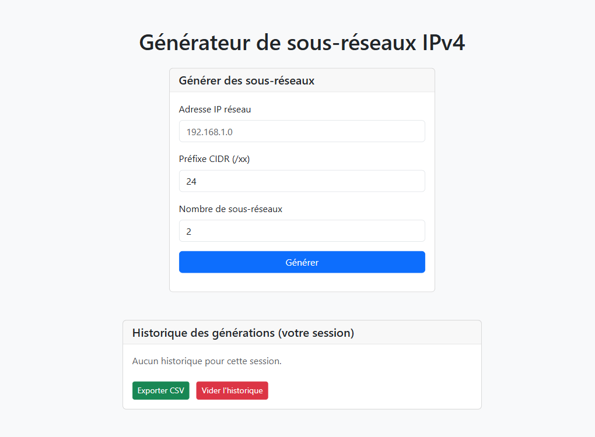
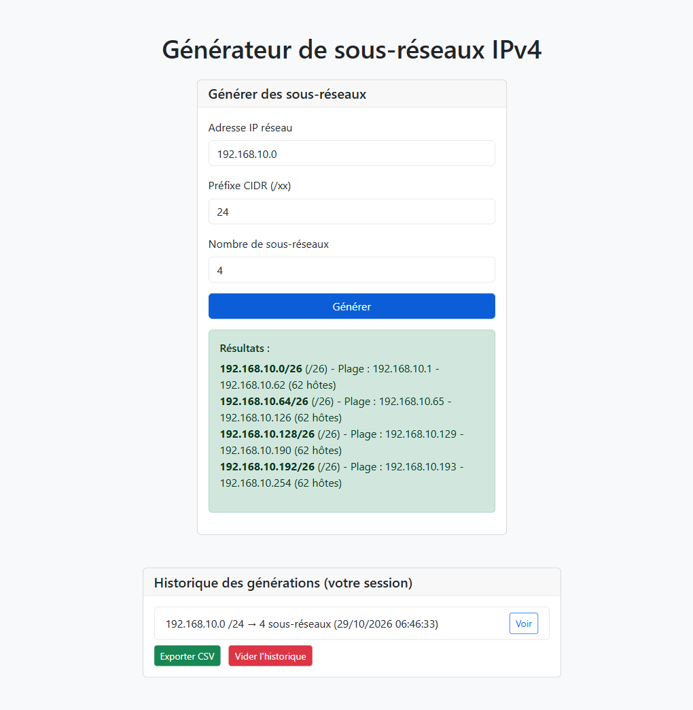
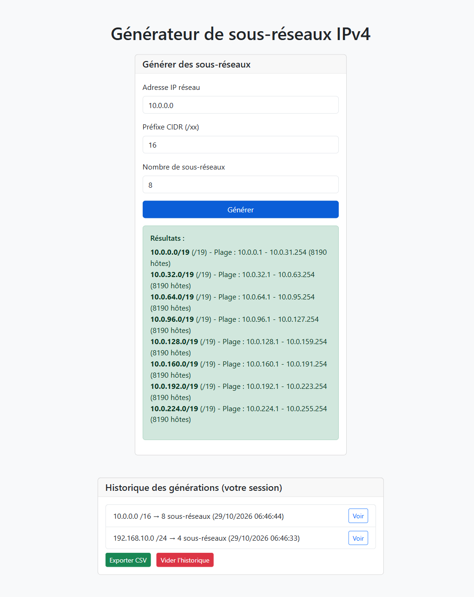

# subnet-tool

Outil web PHP pour générer des sous-réseaux IPv4 à partir d'un réseau source et d'un préfixe CIDR. Isolation par session, historique persistant en base de données.

## Captures d'écran

### Page principale


### Résultats de génération


### Historique de session


## Fonctionnalités

- Calcul des sous-réseaux IPv4 par subdivision CIDR
- Isolation des données par session PHP (`user_id = session_id()`)
- Historique des 20 dernières générations par session
- Export CSV de l'historique
- Suppression de l'historique de session

## Architecture

Projet PHP sans framework. Chaque fichier est un endpoint indépendant :

| Fichier | Méthode | Rôle |
|---|---|---|
| `index.php` | GET | Interface HTML + JS |
| `generate.php` | POST JSON | Calcul + persistance |
| `history.php` | GET JSON | Historique de la session |
| `view_history.php` | GET JSON `?id=N` | Détail d'une entrée |
| `export.php` | GET | Export CSV |
| `clear_history.php` | POST | Suppression de l'historique |

## Base de données

```sql
CREATE TABLE history (
    id          INT UNSIGNED NOT NULL AUTO_INCREMENT PRIMARY KEY,
    ip          VARCHAR(45)  NOT NULL,
    cidr        TINYINT UNSIGNED NOT NULL,
    num_subnets INT UNSIGNED NOT NULL,
    user_id     VARCHAR(128) NOT NULL,
    results     JSON         NOT NULL,
    created_at  TIMESTAMP    NOT NULL DEFAULT CURRENT_TIMESTAMP
);
CREATE INDEX idx_history_user_id ON history (user_id);
```

> Utiliser `TEXT` à la place de `JSON` si MariaDB < 10.2.

## Démarrage rapide

1. Copier `config.example.php` vers `config.php` et renseigner vos identifiants MySQL.
2. Créer la base et la table :

```sql
CREATE DATABASE subnet_tool CHARACTER SET utf8mb4 COLLATE utf8mb4_unicode_ci;
USE subnet_tool;
-- coller le CREATE TABLE ci-dessus
```

3. Lancer un serveur de développement PHP à la racine du projet :

```powershell
php -S localhost:8000
```

4. Ouvrir `http://localhost:8000/index.php` dans votre navigateur.

## Remarques

- **CSRF** : pas de protection CSRF sur `generate.php` et `clear_history.php`, à ajouter si l'application est exposée publiquement.
- **Bootstrap** chargé depuis CDN (`cdn.jsdelivr.net`), requiert une connexion Internet.
- **`num_subnets`** n'est pas plafonné côté serveur, une valeur très élevée peut générer des milliers de sous-réseaux.